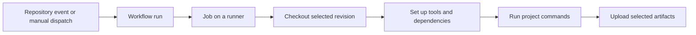

# GitHub Actions: a practical guide to creation and configuration

This guide explains how to design, create, configure, operate and maintain GitHub Actions workflows for almost any software project. Aqaqeer provides a real Android example; its JDK, SDK, Gradle tasks, package names and file paths are examples rather than universal defaults.

The reader's local development system is **Ubuntu 26.04.1**, as supplied by the project owner. A workflow can independently select a different GitHub-hosted operating system. This distinction matters throughout the guide.

Documentation reviewed: **2026-11-13**. GitHub.com is the reference platform; GitHub Enterprise Server can differ in supported actions and features. Examples are teaching material unless identified as the current Aqaqeer workflow. Creating this guide did not execute any example, build, test, deployment or GitHub command.

For Aqaqeer's authoritative commands and current toolchain, use [Building Aqaqeer](build.md). The executable configuration is [android.yml](../.github/workflows/android.yml); execution evidence belongs in [validation](validation.md), and pending work belongs in [plan](plan.md).

## Contents

1. [Understand the execution model](#understand-the-execution-model)
2. [Inspect a project before designing CI](#inspect-a-project-before-designing-ci)
3. [Prepare repository settings](#prepare-repository-settings)
4. [Create a first workflow](#create-a-first-workflow)
5. [Read and write workflow YAML](#read-and-write-workflow-yaml)
6. [Choose events and filters](#choose-events-and-filters)
7. [Choose runners and toolchains](#choose-runners-and-toolchains)
8. [Choose and pin actions](#choose-and-pin-actions)
9. [Write reliable command steps](#write-reliable-command-steps)
10. [Use variables, inputs and secrets](#use-variables-inputs-and-secrets)
11. [Pass data between steps and jobs](#pass-data-between-steps-and-jobs)
12. [Control job order and failure](#control-job-order-and-failure)
13. [Use dependency caches](#use-dependency-caches)
14. [Publish and download artifacts](#publish-and-download-artifacts)
15. [Expand with matrices](#expand-with-matrices)
16. [Reuse workflows and create actions](#reuse-workflows-and-create-actions)
17. [Set security boundaries](#set-security-boundaries)
18. [Separate builds from deployments](#separate-builds-from-deployments)
19. [Operate and troubleshoot workflows](#operate-and-troubleshoot-workflows)
20. [Control cost and maintain configuration](#control-cost-and-maintain-configuration)
21. [Study the Aqaqeer Android example](#study-the-aqaqeer-android-example)
22. [Adapt the design to other projects](#adapt-the-design-to-other-projects)
23. [Review before enabling a workflow](#review-before-enabling-a-workflow)
24. [Frequently asked questions](#frequently-asked-questions)

## Understand the execution model

GitHub Actions runs processes in response to repository events. Continuous integration, or CI, commonly builds and checks proposed changes. Continuous delivery prepares deployable outputs; continuous deployment also publishes them automatically. A manually triggered APK build is useful automation even without automatic push or pull-request checks.

| Term | Meaning | Example |
| --- | --- | --- |
| Workflow | A YAML automation definition | `.github/workflows/android.yml` |
| Event | What starts execution | A manual `workflow_dispatch` |
| Run | One execution of a workflow | A specific build shown under Actions |
| Job | A group of steps assigned to a runner | `build-debug` |
| Runner | The machine or execution environment for a job | GitHub-hosted Ubuntu |
| Step | One operation inside a job | Set up Java, then invoke Gradle |
| Action | A reusable component called with `uses` | `actions/checkout` |
| Artifact | A retained output of a run | An APK or report archive |
| Cache | Reusable data intended to speed future work | Downloaded Gradle dependencies |

Workflow files live directly in `.github/workflows/` and use `.yml` or `.yaml`. A repository can contain several workflows. Jobs without dependencies may run concurrently; steps within a job run in order. A checkout step downloads the selected repository revision into the job's workspace. Editing a local workflow file alone does not cause GitHub to execute it. See GitHub's [workflow overview](https://docs.github.com/en/actions/concepts/workflows-and-actions/workflows).



Use this sequence to reason about failures. A failure before checkout is usually unrelated to application compilation. A successful build followed by an upload failure is a delivery problem. A downloaded binary still needs the appropriate runtime and acceptance checks.

## Inspect a project before designing CI

Start with evidence from the repository rather than a copied template. Write down the command, prerequisites and expected outputs before writing YAML.

| Question | Where to look | Design consequence |
| --- | --- | --- |
| What actually builds the project? | README, build documentation, scripts | Invoke the supported entry point |
| Which versions are pinned? | Wrappers, lockfiles, version catalogs | Install compatible runtimes |
| What is the repository layout? | Module definitions and source directories | Set the correct working directory |
| What output is expected? | Build configuration and packaging scripts | Upload the correct paths |
| Does packaging have side effects? | Version, copy, signing and publishing hooks | Account for them explicitly |
| What depends on local state? | Ignored config, SDK paths, credentials | Replace with intentional CI configuration |
| Which checks are authorized? | Contributor rules and task scope | Avoid silently adding unrelated execution |
| Can a clean machine build it? | Tracked files and dependency declarations | Identify missing prerequisites |

For Android, inspect the Gradle wrapper properties, root and module build scripts, settings, version catalog and relevant production packaging helpers. Check `compileSdk`, Java/Kotlin targets, product flavors, build types, signing configuration and custom output handling. A module is not necessarily called `app`, and a flavored output is not generally located at `app/build/outputs/apk/debug/`.

Read wrappers before substituting a system-installed build tool. Aqaqeer's wrapper reserves a build code through a tracked Python helper before starting Gradle. Replacing `./gradlew` with `gradle` would bypass that project behavior. Other projects may similarly configure dependency mirrors, checksums or bootstrap steps. Gradle documents the wrapper files and distribution verification in its [Wrapper guide](https://docs.gradle.org/current/userguide/gradle_wrapper.html).

Lightweight Git checks can establish file availability without running the build:

```sh
git ls-files --stage gradlew gradlew.bat gradle/wrapper gradle/build_version.py
git check-ignore --no-index gradlew gradlew.bat gradle/wrapper/gradle-wrapper.jar
```

The helper path is specific to Aqaqeer. `git check-ignore` normally returns exit code 1 when no supplied path matches an ignore rule; that result is useful evidence rather than a failed build. Tracked status and ignore rules answer different questions, which is why `--no-index` is useful here.

## Prepare repository settings

Open the repository's **Settings → Actions → General** when you have the necessary administrative access. Check whether Actions is enabled and whether repository or organization policy permits the selected actions and reusable workflows. A restricted policy can reject an otherwise valid YAML file. Check artifact retention, fork contribution policy and workflow token defaults as appropriate. Organization policy can constrain repository choices. See [repository Actions settings](https://docs.github.com/en/repositories/managing-your-repositorys-settings-and-features/enabling-features-for-your-repository/managing-github-actions-settings-for-a-repository).

Ordinary source compilation should not require permission to write repository contents. Start with a narrow permission declaration, such as `contents: read` for a checkout-based build. Add publishing permissions only to the job that needs them. Do not switch every workflow to broad write access merely to troubleshoot one failing action.

For a private repository, also check the account's available runner usage and storage. If a job stays queued, runner availability, policy or usage limits may explain it before any source command has run.

No deployment environment or signing secret is needed just to create a text artifact or to build a normally configured Android debug APK. Add those resources when the workflow has a concrete purpose for them.

## Create a first workflow

Begin with a small workflow that produces an unmistakable output. The following complete example is independent of any programming language. It checks out the repository, creates a text file and uploads it. It does not compile the application.

Create `.github/workflows/manual-artifact.yml` with:

```yaml
name: Manual artifact example

on:
  workflow_dispatch:

permissions:
  contents: read

jobs:
  create-artifact:
    runs-on: ubuntu-24.04
    timeout-minutes: 10
    steps:
      - name: Check out source
        uses: actions/checkout@3d3c42e5aac5ba805825da76410c181273ba90b1 # v7.0.1
        with:
          persist-credentials: false

      - name: Create output
        shell: bash
        run: |
          mkdir -p output
          printf '%s\n' 'Created by GitHub Actions' > output/message.txt

      - name: Upload output
        uses: actions/upload-artifact@cf430e030ddbb5b0abf93d22962f4752f3646cd9 # v7.0.2
        with:
          name: example-${{ github.run_number }}-${{ github.run_attempt }}
          path: output/message.txt
          if-no-files-found: error
          retention-days: 7
```

The action pins are the reviewed v4 commits used in this repository, not a statement that v4 is the newest available major release. Review the official action repository and compatibility requirements when selecting versions for another project.

To activate this example in another repository:

1. Review the file and any applicable contributor rules.
2. Commit and push it through that repository's normal review process.
3. Ensure a dispatch-enabled workflow exists on the default branch.
4. Open **Actions**, select **Manual artifact example**, and choose **Run workflow**.
5. Select the intended branch, start the run, open the job and inspect its logs.
6. Download the artifact from the run page before it expires.

These are reader instructions; this guide's creation did not commit, push or dispatch anything. Manual dispatch requires appropriate repository access. GitHub explains the default-branch requirement and browser/CLI dispatch options in [Manually running a workflow](https://docs.github.com/en/actions/how-tos/manage-workflow-runs/manually-run-a-workflow).

## Read and write workflow YAML

YAML uses indentation to represent structure. Use spaces consistently and avoid tabs. A mapping contains named values; a sequence uses `-` items. Keep related values at the same indentation depth.

| Key | Purpose |
| --- | --- |
| `name` | Display name in the Actions interface |
| `on` | Events and event-specific configuration |
| `permissions` | Access requested for the automatic GitHub token |
| `jobs` | Job definitions keyed by stable identifiers |
| `runs-on` | Runner label or label selection |
| `steps` | Ordered commands and actions |
| `uses` | Action reference, or a reusable workflow at job level |
| `with` | Inputs accepted by the selected action |
| `run` | Shell script executed on the runner |
| `env` | Environment variables for a scope |

Use `|` for a readable multiline script. Quote version strings such as `'21'` so YAML does not interpret them as numbers. Quote values containing YAML-significant punctuation when needed. GitHub expressions use `${{ ... }}`; they are separate from the shell syntax inside `run`.

An action input only has meaning if that action supports it. A generic `with: java-version:` under checkout does not install Java. Action names, versions and inputs come from the action's own `action.yml` and documentation. GitHub's [workflow syntax reference](https://docs.github.com/en/actions/reference/workflows-and-actions/workflow-syntax) defines the surrounding YAML schema.

A generic YAML parser checks syntax, not the full Actions schema. Some YAML 1.1 parsers interpret the key `on` as a boolean; choose a suitable loader when inspecting a workflow programmatically. Successfully parsing a file does not verify action existence, permissions, SDK downloads, shell behavior or artifact production.

## Choose events and filters

Decide whether the workflow should run automatically before adding event declarations.

| Event | Typical use | Important boundary |
| --- | --- | --- |
| `workflow_dispatch` | A person requests a build | Workflow discovery requires the default branch |
| `push` | Validate selected branches or tags | A push can cause many runs |
| `pull_request` | Check proposed changes | Treat contributor code as untrusted |
| `schedule` | Periodic maintenance | Scheduled execution is not a precise timer |
| `workflow_call` | Reuse a workflow from another workflow | Define a deliberate input/output interface |
| `release` | React to release activity | Choose activity types intentionally |

An automatic-trigger fragment might be:

```yaml
on:
  push:
    branches: [main]
  pull_request:
    branches: [main]
  workflow_dispatch:
```

For `pull_request`, `branches` filters the target/base branch. A schedule commonly uses UTC cron syntax; for example, `17 3 * * 1` means Monday at 03:17 UTC. GitHub may delay scheduled runs under load. Confirm event behavior in [Events that trigger workflows](https://docs.github.com/en/actions/reference/workflows-and-actions/events-that-trigger-workflows).

Path filters help avoid unnecessary work in large repositories. Include build configuration, wrapper scripts, lockfiles and shared code that can affect the output. Combining branch and path filters narrows execution to changes meeting both conditions. Required-check design needs care: a skipped workflow can leave a required check pending and block merging. Add filters only after understanding the branch protection and check names.

Keep manual workflows manual when that is the desired policy. Adding `push` merely because it appears in a starter template changes when commands and costs occur. Aqaqeer's current APK workflow has only `workflow_dispatch`.

## Choose runners and toolchains

### Local Ubuntu and hosted Ubuntu are independent

The owner's **Ubuntu 26.04.1** runs the editor, local shell and local development tools. A job with `runs-on: ubuntu-24.04` runs on GitHub's separate hosted machine. It does not downgrade the local computer, access its Desktop or inherit its installed SDK. GitHub describes the isolation and available image model in [GitHub-hosted runners](https://docs.github.com/en/actions/concepts/runners/github-hosted-runners).

| Choice | What it selects | What it does not guarantee |
| --- | --- | --- |
| `ubuntu-latest` | GitHub's current latest Ubuntu runner label | A permanently fixed Ubuntu release |
| `ubuntu-24.04` | The hosted Ubuntu 24.04 release family | A frozen package/image snapshot |
| `ubuntu-26.04` | A hosted 26.04 label, where currently supported | An exact match to local 26.04.1 |
| `self-hosted` | A registered runner you operate | Clean state or hosted-runner isolation |

Do not invent a runner label such as `ubuntu-26.04.1` from a local point-release number. Check the supported labels and software inventory in the official [runner-images repository](https://github.com/actions/runner-images). A pinned release reduces major operating-system changes while still receiving image updates. A switch to another release is a workflow change that should receive its own first-run verification.

Self-hosting is appropriate when a job needs controlled hardware, a private network or a managed persistent environment. You then own OS/tool updates, permissions, isolation and cleanup. Registering your workstation as a runner gives remote workflow code a place to execute on that machine; it is a deliberate operational choice. See [self-hosted runners](https://docs.github.com/en/actions/concepts/runners/self-hosted-runners).

### Install compatible runtimes explicitly

Select the runtime from project evidence: Node from the supported project version, Python from the package requirements, Java from the build-tool compatibility and toolchain configuration. An OS label does not fully define the language environment.

For Android, distinguish the JDK running Gradle from the Java language level and generated bytecode target. Aqaqeer's documented build JDK is 21, while Java and Kotlin bytecode target 17. The values can differ legitimately. See Android's [Java versions in Android builds](https://developer.android.com/build/jdks).

```yaml
- name: Set up Java
  uses: actions/setup-java@77dd5b2ce225ea11469928ac317850245a74ae78 # v6.2.0
  with:
    distribution: temurin
    java-version: '21'
```

Prefer wrappers and lockfiles to unbounded tool installation. Do not assume a hosted global Gradle version matches the project wrapper. Likewise, inspect the supported SDK packages rather than assuming that every current platform is preinstalled.

## Choose and pin actions

An action reference identifies both a repository/path and a revision:

```yaml
uses: owner/repository/path@revision
```

The path is optional. `gradle/actions/setup-gradle` is an action in the `setup-gradle` directory of `gradle/actions`; `actions/checkout` uses the action at its repository root.

| Revision form | Benefit | Tradeoff |
| --- | --- | --- |
| Branch such as `main` | Follows development automatically | Can change without your review |
| Major tag such as `v4` | Receives updates within a major | Tag can resolve to a different commit later |
| Specific release tag | Communicates a release version | A tag is still a movable reference |
| Full commit hash | Selects the action code explicitly | Updates require a reviewed change |

When pinning, resolve the release from the official repository and verify the commit belongs there. Annotated tags can point to tag objects that must be resolved to a commit. Keep a comment with the corresponding release for humans; the hash controls execution. Pinning is a supply-chain measure, not proof that the selected code is bug-free. GitHub's [secure-use guidance](https://docs.github.com/en/actions/reference/security/secure-use) recommends full-length commit references.

Review runtime compatibility, supported inputs, maintenance status and permissions before choosing an action. A familiar publisher name is useful context, but it does not replace reviewing what the action does. Update pins deliberately instead of freezing them indefinitely.

## Write reliable command steps

Prefer the same supported command entry points used by developers. Keep complex logic in a reviewed repository script when it becomes difficult to understand in YAML. A workflow should make orchestration visible without becoming an unrelated build system.

```yaml
- name: Run a repository script
  shell: bash
  working-directory: tools
  run: ./create-report.sh
```

This fragment assumes that `tools/create-report.sh` exists and has the intended behavior; it is not a file added by this guide. A working directory affects a command's relative paths. An action's `path` input may follow its own documented path rules.

Use `shell: bash` when Bash behavior is required. Quote shell variables such as `"$OUTPUT_DIR"`. Use explicit failure handling for pipelines when it matters; `set -euo pipefail` is useful in scripts designed for those semantics but can expose intentionally optional variables. Do not hide packaging failures with `|| true` or blanket `continue-on-error`.

Steps in one job share the workspace, but each `run` starts a new shell process. A plain `export` inside one step does not configure subsequent steps. Separate jobs should be treated as separate machines; transfer data intentionally through outputs or artifacts.

On Linux, scripts need executable permissions and compatible line endings. Aqaqeer tracks `gradlew` as executable; shared Android setup checks its tracked `100755` mode and executable bit instead of rewriting permissions in each workflow.

## Use variables, inputs and secrets

### Choose the right configuration channel

| Mechanism | Use for | Example |
| --- | --- | --- |
| `env` | Values scoped to workflow, job or step | `OUTPUT_DIR: output` |
| `vars` | Reusable non-secret repository/org/environment configuration | `${{ vars.REGION }}` |
| `inputs` | Typed manual or reusable-workflow parameters | `${{ inputs.flavor }}` |
| `secrets` | Credentials supplied securely to a workflow | `${{ secrets.DEPLOY_TOKEN }}` |
| `github` | Event and run metadata | `${{ github.sha }}` |

Configuration variables are not secret storage. Shell syntax such as `$OUTPUT_DIR` is evaluated on the runner; `${{ vars.REGION }}` is a GitHub expression. The permitted contexts depend on the YAML field. See [variables](https://docs.github.com/en/actions/how-tos/write-workflows/choose-what-workflows-do/use-variables) and the [contexts reference](https://docs.github.com/en/actions/reference/workflows-and-actions/contexts).

### Add deliberate manual inputs

This trigger fragment offers a flavor choice; it does not alter Aqaqeer's current workflow:

```yaml
on:
  workflow_dispatch:
    inputs:
      flavor:
        description: Debug flavor to build
        required: true
        type: choice
        default: standard
        options:
          - standard
          - demo
```

Map input to allowed behavior rather than treating it as an arbitrary shell command:

```yaml
- name: Select and build flavor
  env:
    REQUESTED_FLAVOR: ${{ inputs.flavor }}
  shell: bash
  run: |
    case "$REQUESTED_FLAVOR" in
      standard) task=:app:assembleStandardDebug ;;
      demo) task=:app:assembleDemoDebug ;;
      *) printf '%s\n' 'Unsupported flavor' >&2; exit 1 ;;
    esac
    ./gradlew --no-daemon -Paqaqeer.exportApks=false "$task"
```

This Android-specific fragment would need a matching artifact path and the prerequisite setup steps. Passing a value through `env` keeps it out of script source interpolation; the allowlist prevents unexpected task selection. Avoid interpolating free-form pull-request text or user input directly into `run`.

### Supply secrets only where needed

Create a secret through the repository, organization or environment settings appropriate to its scope. Reference it only in the consuming step, for example as an environment variable. An unset secret expression can produce an empty value, so a consuming script should check for required configuration without printing its contents.

Secret masking is a safeguard, not permission to print credentials. Avoid dumping all environment/context values, using shell tracing around credentials, or uploading entire workspaces. Base64-encoding a key is transport encoding, not encryption. Fork pull requests and reusable workflows have additional secret-availability rules. See [Using secrets](https://docs.github.com/en/actions/how-tos/write-workflows/choose-what-workflows-do/use-secrets).

## Pass data between steps and jobs

Write small step outputs to the runner-provided `$GITHUB_OUTPUT` file:

```yaml
- name: Record a build label
  id: metadata
  shell: bash
  run: printf '%s\n' 'label=manual-preview' >> "$GITHUB_OUTPUT"

- name: Read the label
  env:
    BUILD_LABEL: ${{ steps.metadata.outputs.label }}
  run: printf '%s\n' "$BUILD_LABEL"
```

To make a non-secret environment value available to later steps of the same job, write `NAME=value` to `$GITHUB_ENV`. It does not retroactively change the current shell. Use `$GITHUB_PATH` to extend later steps' executable search path. `$GITHUB_STEP_SUMMARY` accepts Markdown for a concise run summary. These are environment files with specific semantics, described in [Workflow commands](https://docs.github.com/en/actions/reference/workflows-and-actions/workflow-commands).

For a later job, expose a step output at job level:

```yaml
jobs:
  identify:
    runs-on: ubuntu-24.04
    outputs:
      label: ${{ steps.metadata.outputs.label }}
    steps:
      - id: metadata
        run: printf '%s\n' 'label=manual-preview' >> "$GITHUB_OUTPUT"
  report:
    needs: identify
    runs-on: ubuntu-24.04
    steps:
      - env:
          BUILD_LABEL: ${{ needs.identify.outputs.label }}
        run: printf '%s\n' "$BUILD_LABEL"
```

This is a `jobs` fragment requiring an enclosing workflow trigger. Outputs carry small metadata, not a filesystem or a secure credential vault. Use artifacts for files. GitHub documents the step-to-job mapping in [Passing information between jobs](https://docs.github.com/en/actions/how-tos/write-workflows/choose-what-workflows-do/pass-job-outputs).

## Control job order and failure

### Express dependencies explicitly

Use `needs` when a job depends on another job's result. Giving jobs names such as `first` and `second` does not order them. A build-and-release design might have independent static checks and compilation, followed by a release job that requires both. A failed prerequisite normally prevents dependent jobs from running.

Conditions support explicit status functions:

| Condition | Intended use |
| --- | --- |
| `success()` | Continue after successful preceding work |
| `failure()` | Collect failure-specific diagnostics |
| `cancelled()` | Respond to cancellation |
| `always()` | Run even when preceding work failed or was cancelled |
| `!cancelled()` | Perform follow-up work unless the run is cancelled |

Ordinary steps carry a default success condition. Use an explicit condition when preserving diagnostics after a failure. Avoid putting a long or network-dependent operation behind `always()` merely to force it to run during cancellation. For expected binary uploads, a normal success-only step prevents a failed build from presenting an old file as its deliverable. See GitHub's [expression and status-function reference](https://docs.github.com/en/actions/reference/workflows-and-actions/expressions).

Set a job timeout and, where helpful, a timeout for a potentially blocking step. Use `continue-on-error` only when failure is genuinely non-blocking and the run summary makes the distinction clear. A green run containing an ignored failure is not equivalent to every check passing.

### Prevent conflicting executions

Concurrency groups coordinate runs that should not overlap:

```yaml
concurrency:
  group: preview-${{ github.workflow }}-${{ github.ref }}
  cancel-in-progress: true
```

This fragment favors a newer preview over an in-progress preview for the same workflow/ref. Include enough identity to avoid unrelated workflows sharing a group accidentally. For deployment, cancellation may be inappropriate once external mutation starts; serialization and application-specific recovery may be preferable.

A concurrency group is not a durable first-in/first-out work queue. Pending-run replacement and ordering rules matter if every requested job must execute. GitHub's [concurrency guide](https://docs.github.com/en/actions/how-tos/write-workflows/choose-when-workflows-run/control-workflow-concurrency) describes the behavior. Do not use workflow concurrency as a substitute for transactional release numbering or a lock shared with external systems.

## Use dependency caches

A cache improves speed by restoring reusable data from previous jobs. Design for a cold cache first: its absence must not prevent correct dependency resolution. Cache hits are an optimization, not a proof of correctness or a substitute for declaring dependencies.

| Data | Usual treatment |
| --- | --- |
| Downloaded public dependencies | Good cache candidate |
| Package-manager metadata | Cache with compatible tool/runtime inputs |
| Final APK/archive | Publish as an artifact |
| Credentials, signing keys, private configuration | Keep out of general caches |
| Machine-specific absolute paths | Avoid assuming portability |
| Authoritative release counter | Use deliberate durable coordination |

Prefer a maintained ecosystem-specific cache integration when it fits the build. For a manually designed cache, consider operating system, architecture, toolchain version and lockfile hash. A cache key that ignores dependency changes risks reusing incompatible data. A key including every commit may discard most reuse. Keep restore fallbacks compatible and avoid caching arbitrary executable output from untrusted sources into a trusted job. See [dependency caching](https://docs.github.com/en/actions/concepts/workflows-and-actions/dependency-caching).

For Aqaqeer, `gradle/actions/setup-gradle` manages Gradle state. It does not replace the wrapper or determine the requested task. Avoid configuring overlapping Gradle caches through both setup-java and setup-gradle without understanding their interactions. The shared setup explicitly uses the basic GitHub cache provider and permits writes only on the default branch; a feature-branch manual build may restore data without saving a new cache. GitHub's cache allowance is unchanged.

Gradle's dependency cache, task-output build cache and configuration cache are different layers. Aqaqeer enables build/configuration caching in `gradle.properties`, but cross-run configuration-cache persistence through setup-gradle has separate encryption-key requirements. No such secret was added here. Read [setup-gradle's cache documentation](https://github.com/gradle/actions/blob/v6.4.1/docs/setup-gradle.md) before claiming configuration-cache reuse across hosted runs.

## Publish and download artifacts

Artifacts are outputs people or later jobs need to retain: binaries, generated documentation, reports or deliberately selected diagnostics. An artifact belongs to a run and has retention/access rules; it is not automatically a public download page, a GitHub Release asset or permanent storage. GitHub explains this model in [Workflow artifacts](https://docs.github.com/en/actions/concepts/workflows-and-actions/workflow-artifacts).

```yaml
- name: Upload generated files
  uses: actions/upload-artifact@cf430e030ddbb5b0abf93d22962f4752f3646cd9 # v7.0.2
  with:
    name: generated-files-${{ github.run_number }}-${{ github.run_attempt }}
    path: output/*.zip
    if-no-files-found: error
    retention-days: 14
```

Choose a narrow path. Fail when an expected deliverable is absent. Use distinct artifact names for matrix jobs and variants. The reviewed upload-artifact v4 model does not support repeatedly appending files from different jobs to the same named artifact. Hidden files are excluded by default in current v4 behavior; enabling their inclusion needs deliberate review. Retention cannot exceed the effective repository/organization limit. See the action's [v4 documentation](https://github.com/actions/upload-artifact/blob/v4/README.md).

For a later job, use a compatible `actions/download-artifact` release, pin its commit, and select the expected artifact explicitly. Do not assume another job's workspace already contains the file. Match the upload/download action's GitHub.com or Enterprise Server support before copying a cross-job example.

Download through the run page's **Artifacts** area, or through the CLI after authentication. Artifact access follows GitHub's permissions, and artifacts can expire. Follow the official [download instructions](https://docs.github.com/en/actions/how-tos/manage-workflow-runs/download-workflow-artifacts).

Artifact names should communicate purpose and identity. A name such as `standard-debug-42-2` can distinguish workflow run 42, attempt 2, but it does not mean Android `versionCode` is 42. Retain source revision, selected variant and toolchain provenance when binary traceability matters. A checksum helps compare bytes; it does not prove behavioral correctness.

## Expand with matrices

A matrix generates job combinations from configuration values:

```yaml
jobs:
  demonstrate-platforms:
    strategy:
      fail-fast: false
      max-parallel: 2
      matrix:
        os: [ubuntu-24.04, ubuntu-26.04]
    runs-on: ${{ matrix.os }}
    steps:
      - name: Show selected platform
        env:
          SELECTED_PLATFORM: ${{ matrix.os }}
        run: printf '%s\n' "$SELECTED_PLATFORM"
```

This is an optional teaching fragment, not an enabled compatibility campaign. Verify both runner labels are available to the target account before adopting it. Adding another axis multiplies combinations: two OS values and three runtime values produce six jobs before exclusions.

Use `include` for specific additional combinations and `exclude` for unsupported ones. `fail-fast: false` lets other matrix jobs continue after one fails; this can preserve diagnostic breadth at higher cost. `max-parallel` limits simultaneous jobs rather than total work. Use matrices when the differences answer a real compatibility question, and choose distinct artifact names containing the relevant matrix values. See [Running variations of jobs](https://docs.github.com/en/actions/how-tos/write-workflows/choose-what-workflows-do/run-job-variations).

## Reuse workflows and create actions

### Choose the right reuse level

| Mechanism | Good use | Location/interface |
| --- | --- | --- |
| Repository script | Share command logic between local use and CI | Ordinary script invoked with `run` |
| Composite action | Share several steps inside a job | Directory containing `action.yml` |
| JavaScript action | Implement runner integration in JavaScript | Action metadata and packaged runtime code |
| Docker action | Execute packaged Linux-container tooling | Action metadata plus container configuration |
| Reusable workflow | Share complete jobs and orchestration | Workflow with `on: workflow_call` |
| Workflow template | Offer a starting configuration for repositories | Template copied/customized by consumers |

A composite action runs within its caller's job. A reusable workflow is called at job level and defines its own jobs; do not place the call under `steps`. Prefer scripts for logic that developers should also run outside Actions. GitHub compares these choices in [Reusing workflow configurations](https://docs.github.com/en/actions/concepts/workflows-and-actions/reusing-workflow-configurations).

### Create a small composite action

The following optional file would live at `.github/actions/write-label/action.yml`:

```yaml
name: Write build label
description: Display a caller-provided non-secret label
inputs:
  label:
    description: Label to display
    required: true
runs:
  using: composite
  steps:
    - shell: bash
      env:
        BUILD_LABEL: ${{ inputs.label }}
      run: printf '%s\n' "$BUILD_LABEL"
```

After checkout, a caller step could use it as follows:

```yaml
- name: Display label
  uses: ./.github/actions/write-label
  with:
    label: preview
```

The local action directory must actually exist in the checked-out revision. Document inputs and outputs, quote input data, and avoid hidden side effects. If published in another repository, reference a reviewed commit like any other external action. See GitHub's [composite-action tutorial](https://docs.github.com/en/actions/tutorials/create-actions/create-a-composite-action) and [action metadata reference](https://docs.github.com/en/actions/reference/workflows-and-actions/metadata-syntax). This guide does not add or publish this action.

### Create a reusable workflow

A reusable workflow can declare a typed interface:

```yaml
name: Reusable label report
on:
  workflow_call:
    inputs:
      label:
        required: true
        type: string
permissions:
  contents: read
jobs:
  report:
    runs-on: ubuntu-24.04
    steps:
      - env:
          BUILD_LABEL: ${{ inputs.label }}
        run: printf '%s\n' "$BUILD_LABEL"
```

If saved as `.github/workflows/reusable-label.yml`, another workflow could call it with this `jobs` fragment:

```yaml
jobs:
  report:
    uses: ./.github/workflows/reusable-label.yml
    with:
      label: preview
```

Declare and pass secrets intentionally when needed. A callee cannot simply elevate token permissions beyond the caller's allowed permissions. Environment secrets have distinct behavior and should not be assumed equivalent to ordinary passed secrets. A same-repository relative workflow reference follows the caller's commit. External reusable workflows should use a reviewed immutable reference. See [Reuse workflows](https://docs.github.com/en/actions/how-tos/reuse-automations/reuse-workflows).

## Set security boundaries

### Limit the automatic token

GitHub provides a temporary `GITHUB_TOKEN` for workflow jobs. It is separate from a human personal access token. Its effective rights depend on workflow/job declarations and repository policy. Use read access for a source build, and narrowly scoped write access for a concrete publishing purpose. Actions can access the automatic token through the GitHub context, so review every action executed in a privileged job. See [GITHUB_TOKEN](https://docs.github.com/en/actions/concepts/security/github_token).

Setting `persist-credentials: false` on checkout avoids leaving checkout's authentication configured for subsequent Git operations. It does not sandbox later actions or remove every way they could obtain a token. Build dependencies and repository scripts execute code too.

### Treat event data and contributed code as untrusted

Keep ordinary pull-request checks separate from privileged publication. Do not solve missing fork secrets by switching to `pull_request_target` and executing the contributor's code with trusted credentials. That event has a different trust context. Likewise, a workflow that consumes artifacts from another run must validate their origin before granting them privileged treatment. GitHub's [event reference](https://docs.github.com/en/actions/reference/workflows-and-actions/events-that-trigger-workflows) explains these distinctions.

Use environment variables to pass untrusted text into a shell step, quote the variable, and validate its allowed meaning. Do not use `eval` to interpret inputs. Review action pins and workflow changes as executable code changes. See [secure-use practices](https://docs.github.com/en/actions/reference/security/secure-use).

### Protect credentials and signing identity

Keep private keys, service tokens and signing passwords out of Git, logs, ordinary artifacts and caches. Scope secrets to the smallest set of jobs and use disposable temporary files only when a tool requires files. Cleanup should target only files the job owns; it does not replace isolation.

For cloud deployment, OpenID Connect can exchange workflow identity for short-lived provider credentials. The provider must trust an appropriately restricted repository/ref/environment identity. `id-token: write` permits requesting an identity token; it does not itself grant cloud access. Configure and verify both sides. See [OpenID Connect](https://docs.github.com/en/actions/concepts/security/openid-connect).

## Separate builds from deployments

Building creates an output. Uploading a workflow artifact makes that output available within GitHub's artifact system. Publishing a GitHub Release, deploying a website, pushing a package or distributing a signed Android release changes an external delivery surface. Design those as explicit stages with distinct permissions.

A release process should identify the approved source revision, retain or promote the reviewed binary, and record the version/signing identity. Rebuilding after approval can produce different bytes if dependencies or tooling changed; decide whether your policy approves source or an exact artifact.

GitHub environments can apply deployment restrictions and hold environment-scoped secrets. A job references one through `environment: production`; configure the actual environment's rules in repository settings. Feature availability depends on plan and repository visibility. See [Managing deployment environments](https://docs.github.com/en/actions/how-tos/deploy/configure-and-manage-deployments/manage-environments).

For Android, installation updates require coherent package identity, signing identity and version-code policy. A CI debug APK is not automatically a production-signed release. Keep signing configuration separate from a basic debug workflow, and define how approved signing material and monotonic release versions are managed before distributing updates broadly. Android documents command-line build and signing paths in [Build your app from the command line](https://developer.android.com/build/building-cmdline).

## Operate and troubleshoot workflows

### Run and inspect through the browser

Select the intended workflow under **Actions**, open a run, and inspect the first meaningful failing step. Record the selected branch/commit, run identifier, attempt and runner image information. The summary shows job results; expandable logs show individual commands. A cancelled, skipped or queued job should not be recorded as a successful check. See [Using workflow run logs](https://docs.github.com/en/actions/how-tos/monitor-workflows/use-workflow-run-logs).

Re-running a job uses the run's original event/ref/SHA rather than picking up a newly pushed workflow fix. Dispatch a new run to evaluate a changed workflow. Retry a network failure when appropriate, but investigate a deterministic configuration error before repeating the same run. See [Re-running workflows and jobs](https://docs.github.com/en/actions/how-tos/manage-workflow-runs/re-run-workflows-and-jobs).

### Use GitHub CLI when useful

After installing and authenticating `gh` in your own environment, a dispatch example is:

```sh
gh workflow run android.yml --ref main
```

For a workflow that actually declares the optional flavor input:

```sh
gh workflow run android.yml --ref main -f flavor=standard
```

Workflow 06 now declares a `flavor` choice (`standard`, `demo`, `both`); its exact commands and independent job behavior are documented in [build](build.md#manual-quality-and-security-workflows). It does not declare arbitrary example inputs from this tutorial. Replace `main` if the target branch differs. These commands perform remote actions and are shown for the reader, not executed here. See [`gh workflow run`](https://cli.github.com/manual/gh_workflow_run).

To inspect and download a chosen run, substitute its real numeric identifier:

```sh
gh run list --workflow android.yml
gh run view 123456789
gh run view 123456789 --log-failed
gh run download 123456789 --dir ./downloaded-artifacts
```

Run from the intended repository, or select it explicitly with the CLI's repository option. Downloading several artifacts may create separate directories. See [`gh run download`](https://cli.github.com/manual/gh_run_download).

### Diagnose by symptom

| Symptom | Likely boundary to inspect | Useful next step |
| --- | --- | --- |
| No Run workflow button | Default branch, trigger, access or Actions policy | Check the workflow exists on the default branch and declares dispatch |
| Workflow rejected before a runner starts | YAML/schema or action policy | Inspect the reported line and allowed-action policy |
| Job stays queued | Runner label, capacity, usage or approval | Verify supported labels and repository/account state |
| Checkout fails | Ref, repository access or token permissions | Inspect checkout logs and requested revision |
| Wrapper not found | Working directory or tracked files | Verify checkout contents and relative path |
| Permission denied on wrapper | Executable bit or filesystem permissions | Review tracked mode and runner-side `chmod` |
| Java/Gradle compatibility error | Runtime/toolchain mismatch | Compare setup-java, wrapper and plugin requirements |
| SDK/platform/license error | Runner SDK prerequisites | Inspect package name, SDK root and license setup |
| Dependency resolution fails | Network, repository access or missing credentials | Read the resolver error; confirm cold-cache support |
| Build succeeds but artifact is missing | Variant or upload path | Compare actual outputs with the narrow upload pattern |
| Cache never saves | Branch policy, action setup or cache limits | Inspect setup-gradle's post-job logs |
| Later job cannot see a file | Job isolation | Transfer the file as an artifact |
| Secret appears unavailable | Scope, event trust or environment protection | Check configuration without printing the value |
| Required check stays pending | Trigger/path filters or changed check names | Reconcile branch rules with actual job creation |
| APK cannot update an installation | Package, signer or version mismatch | Compare identities; preserve existing app data |
| Build passes but app behavior fails | Runtime/application boundary | Plan the relevant separately authorized acceptance checks |

If ordinary logs are insufficient, GitHub supports runner and step debug logging through documented settings such as `ACTIONS_STEP_DEBUG`. Enable it only for a diagnostic purpose and review log exposure. See [Enabling debug logging](https://docs.github.com/en/actions/how-tos/monitor-workflows/enable-debug-logging).

An SDK package lookup failure does not by itself justify changing the app's API target. In Aqaqeer's reported failure, CI requested `platforms;android-37`, while Google's catalog names the package `platforms;android-37.0`. The fix requests that exact package and explicitly selects minor API level 0 in Gradle. Inspect package identifiers and build-tool support before considering a downgrade; changing `targetSdk` also changes application compatibility behavior.

## Control cost and maintain configuration

Runner usage and storage have plan-specific billing rules. Artifact retention, cache storage, platform choice, matrix size and repeated runs can affect consumption. Avoid copying exact prices or allowances into a durable workflow guide; consult [GitHub Actions billing](https://docs.github.com/en/billing/concepts/product-billing/github-actions) for the current account model.

Use sensible timeouts, narrow triggers and artifact paths. Cancel obsolete previews only when interruption is safe. Schedule periodic work off busy times when practical. Reduce repeated work after understanding which cache layer is effective; do not trade away correctness just to obtain a faster green run.

Assign ownership for action-pin updates, runner changes and toolchain changes. Record why a version was selected and what was actually verified. A successful historical build does not validate a later pin or SDK change. Preserve the first useful failure evidence rather than repeatedly replacing it with partial retries.

Dependabot can propose GitHub Actions dependency updates. The following basic example illustrates the structure; Aqaqeer's current [configuration](../.github/dependabot.yml) additionally groups weekly action updates and limits open proposals:

```yaml
version: 2
updates:
  - package-ecosystem: github-actions
    directory: /
    schedule:
      interval: weekly
```

Review proposed updates, release notes and resulting hashes. Automated proposals do not replace authorization or compatibility checks. See the [Dependabot options reference](https://docs.github.com/en/code-security/reference/supply-chain-security/dependabot-options-reference).

## Study the Aqaqeer Android example

### Configuration established from source

| Item | Current project value | Evidence |
| --- | --- | --- |
| Local development OS | Ubuntu 26.04.1 | Owner-supplied environment |
| Hosted runner | `ubuntu-24.04` | [Workflow](../.github/workflows/android.yml) |
| Trigger | Manual dispatch only | Workflow `on` declaration |
| Module | `:app` | [Gradle settings](../settings.gradle.kts) |
| Wrapper | Gradle 9.4.1 with distribution checksum | [Wrapper properties](../gradle/wrapper/gradle-wrapper.properties) |
| Android plugin | AGP 9.2.1 | [Version catalog](../gradle/libs.versions.toml) |
| Build runtime | Temurin JDK 21 | Workflow and [build documentation](build.md) |
| Java/Kotlin target | 17 | [Module configuration](../app/build.gradle.kts) |
| Compile/target/minimum SDK | 37.0 / 37 / 26 | Module configuration; explicit compile minor API level 0 |
| Installed build tools | 36.0.0 | [Shared toolchain configuration](../.github/android-toolchain.json); [AGP 9.2 compatibility](https://developer.android.com/build/releases/agp-9-2-0-release-notes) |
| Debug flavors | `standard`, `demo` | Module configuration |
| Packaging entry point | POSIX Gradle wrapper | [gradlew](../gradlew) |
| Extra wrapper prerequisite | Python 3.8+ | [Version helper](../gradle/build_version.py) and build documentation |

These values illustrate inspection, not a requirement for other Android apps. JDK 21 follows this project's documented build environment; it is not inferred solely from bytecode target 17.

### Current action references

| Component | Reviewed version | Pinned commit |
| --- | --- | --- |
| Checkout | v7.0.1 | `3d3c42e5aac5ba805825da76410c181273ba90b1` |
| Java setup | v6.2.0 | `77dd5b2ce225ea11469928ac317850245a74ae78` |
| Gradle setup | v6.4.1 | `8da46b539cd8fe6ab27ca75128919a18d757604c` |
| Artifact upload | v7.0.2 | `cf430e030ddbb5b0abf93d22962f4752f3646cd9` |

The pins were resolved from the official repositories' public tag metadata for this workflow. Their immutable commit pages are [checkout](https://github.com/actions/checkout/commit/3d3c42e5aac5ba805825da76410c181273ba90b1), [setup-java](https://github.com/actions/setup-java/commit/77dd5b2ce225ea11469928ac317850245a74ae78), [gradle/actions](https://github.com/gradle/actions/commit/8da46b539cd8fe6ab27ca75128919a18d757604c) and [upload-artifact](https://github.com/actions/upload-artifact/commit/cf430e030ddbb5b0abf93d22962f4752f3646cd9). Pinning does not freeze Ubuntu packages, a major-only JDK selection or all downloaded dependencies.

### What each step accomplishes

1. **Checkout** obtains the selected source revision with persisted Git credentials disabled.
2. **Java setup** selects Temurin 21 rather than relying on a runner default.
3. **Gradle setup** configures caching without replacing the pinned wrapper.
4. **SDK installation** explicitly requests `platforms;android-37.0` and build tools 36.0.0 through the hosted SDK tools. The module selects `release(37)` with `minorApiLevel = 0`; the API target remains 37.
5. **Executable permission** is checked against the tracked `100755` mode; setup does not rewrite wrapper permissions.
6. **Flavor selection** chooses standard, demo or both. Both creates independent serialized jobs with fail-fast disabled.
7. **Assembly** uses the shared selector and normal version-reserving wrapper for that job’s flavor.
8. **APK upload** retains only the selected app’s APK; diagnostics/checksums also identify the flavor. Standard opens setup; demo opens its local psychiatry sample catalog.

Each matrix job passes its validated `standard` or `demo` flavor through an environment value:

```sh
python3 tools/build_debug.py "$CI_BUILD_FLAVOR" --no-export
```

The selector invokes `:app:assembleStandardDebug` or `:app:assembleDemoDebug` through the wrapper. It adds `--no-daemon`, `--console=plain` and `-Paqaqeer.exportApks=false` for this CI command.

`--no-daemon` avoids relying on a persistent daemon lifecycle between hosted runs. `--console=plain` keeps logs readable. The custom `aqaqeer.exportApks=false` property disables this project's Desktop copying behavior. It is not a general Android or Gradle option.

The selected flavor resolves one of these upload patterns:

```text
app/build/outputs/apk/standard/debug/*.apk
app/build/outputs/apk/demo/debug/*.apk
```

The expected conventional names are `app-standard-debug.apk` and `app-demo-debug.apk`. The simpler unflavored pattern `app/build/outputs/apk/debug/*.apk` would miss these locations. Output layout must be rechecked if flavors, splits or output naming change.

### Versioning and installation limits

The wrapper's counter lives in ignored `local/versioning/`. A fresh hosted checkout starts at code 1 under the normal helper rules. The workflow does not override the reserved property, reset a local counter, or persist an authoritative counter across runners. The artifact's run number labels the download independently of the app version.

The workflow also does not persist an Android debug signing key. Fresh runners can therefore produce different debug signing identities. These APKs do not establish reliable update continuity with one another or with locally signed previews. Standard debug and demo debug have different package identities; neither is the isolated preview package used for earlier local deliveries. Do not uninstall or clear an existing installation to bypass a mismatch.

The separate production publisher, workflow 11, now defines explicit version reservations and permanent-key signing. Its [complete build/signing/release walkthrough](build.md#signed-release-apks-local-and-github) covers setup, local versus hosted codes, GitHub secrets and publication choices. The debug workflow above retains its own numbering/signing limits. A cache is not a reliable release authority: it can be evicted, be unavailable to a branch or be written concurrently.

### What is implemented and what remains unverified

The source workflow defines manual builds with a standard/demo/both selector, prerequisites and an APK upload for each selected flavor job. It contains no push/PR trigger, deployment, release publishing, test run or lint step. The optional examples elsewhere in this guide do not enable those features.

YAML/source checks establish configuration structure. Build/runtime results and their source revisions belong in [validation](validation.md#ci-quality-security-and-diagnostics--2026-11-13); configuration alone does not establish execution success.

Aqaqeer now also defines separate manual [quality](../.github/workflows/quality.yml) and [security](../.github/workflows/security.yml) workflows: actionlint checks workflow correctness, production-only lint produces HTML/XML reports, and CodeQL analyzes both Java/Kotlin production flavors plus Python and Actions, with separate result categories. Java/Kotlin and Python use extended security queries. Summaries record source/run identity, results, findings or APK checksums; narrow diagnostics survive ordinary failures where the runner remains available. The separate manual [tests and compilation workflow](../.github/workflows/verification.yml) now adds standard/demo JVM tests, debug/instrumentation and standard release compilation, plus public JDK crypto-vector verification. That workflow runs no device tests. A separate manual [emulator workflow](../.github/workflows/emulator.yml) now selects six offline invocations per API 29/35 emulator and retains short UI video/failure screenshots; [cleanup](../.github/workflows/cleanup-evidence.yml) now runs daily with seven-day retention and keeps a manual preview/clear button. By explicit owner choice, it deletes completed runs including logs and workflow artifacts/APKs; GitHub Release assets survive. Physical-phone campaigns remain excluded. The newer manual dependency, release-output and repository-integrity workflows add the checks described in [free-tier controls](ci-free-tier.md); artifacts upload automatically with one-day retention, subject to GitHub storage quota; the owner confirmed no saved payment method. The [build documentation](build.md#manual-quality-and-security-workflows) is canonical for their commands, permissions and limits; completed checks and remaining work are recorded in [validation](validation.md) and [plan](plan.md).

## Adapt the design to other projects

Keep the workflow structure and replace the project contract deliberately:

| Project type | Inspect first | Typical setup | Expected output to identify |
| --- | --- | --- | --- |
| Node frontend | Package scripts, lockfile, runtime declaration | Node and the declared package manager | Actual configured site/output directory |
| Python package | `pyproject.toml`, lockfile, interpreter support | Compatible Python and packaging tool | Wheel/source distribution or generated report |
| Java library | Wrapper, toolchain and module definitions | Compatible JDK and Maven/Gradle wrapper | JAR and publication metadata |
| Android app | Wrapper, AGP, SDK and variants | JDK plus Android SDK packages | Flavor/build-type APK or bundle |
| Static documentation | Generator configuration and locked dependencies | Generator runtime | Generated HTML directory |
| Native project | Build system, compiler, platform libraries | Required compiler and SDK | Binary/library/package for the selected platform |

Do not blindly substitute a command such as `npm run build` without checking the scripts it invokes. A repository's build target may run checks, publish packages, update generated files or contact external services. Separate intended effects and authorize them before execution.

For a monorepo, choose the module root, include shared dependencies in trigger/cache design and avoid assuming a root artifact directory. For several platforms, confirm each shell and dependency setup. For a private dependency, define the narrow authentication requirement instead of checking a developer's entire local configuration into Git.

A practical progression is a manual build, a verified artifact path, then automatic integration checks where wanted, followed by explicit release/deployment stages. Each stage should solve a concrete need and have observable success criteria.

## Review before enabling a workflow

Use the following as a configuration review, not as a claim of executed verification:

- The file is directly under `.github/workflows/` and has valid YAML/Actions structure.
- Triggers match the intended automation policy and branch rules.
- The runner label is supported; local OS assumptions are documented separately.
- Runtime/build-tool versions follow the project contract.
- Required wrappers, scripts and lockfiles are tracked and accessible.
- Build commands and their side effects have been reviewed.
- Inputs are validated and secrets are narrowly scoped.
- Token permissions and action references are deliberate.
- Cache design supports a clean run and excludes protected state.
- Artifact paths identify the actual variants and fail when expected outputs are absent.
- Timeouts, cancellation and concurrency behavior fit the operation.
- Publishing/signing/version coordination is explicit if distribution is enabled.
- The first hosted run has a defined review procedure for logs and outputs.
- Documentation distinguishes source checks, hosted builds, runtime checks and human acceptance.

After a real run, record the source revision, runner/toolchain, requested command, job result and retained outputs. Mark skipped, failed, cancelled and unavailable checks accurately. A build pass proves only the boundary it actually exercised.

## Frequently asked questions

### Must GitHub use the same Ubuntu version as my computer?

No. Your local Ubuntu 26.04.1 and the hosted runner are separate environments. Match them when that answers a compatibility need. Otherwise choose a supported hosted image with the required tools and verify the workflow there. Exact point-release equality is not provided by a normal release-family runner label.

### Does pinning Ubuntu and actions make builds fully reproducible?

No. It narrows selected sources of change. Hosted image updates, JDK patch selection, dependency resolution, external repositories, timestamps and nondeterministic build behavior can still change outputs. Reproducible binaries require additional dependency, environment and build controls.

### Does upload-artifact publish a GitHub Release?

No. Workflow artifacts and release assets are separate delivery mechanisms. Choose a publishing process and permissions explicitly if a release download surface is needed.

### Do I need secrets for a debug Android build?

Not usually for public dependencies and ordinary debug signing. Private repositories or dependencies may require authentication. Production signing and deployment have separate credential requirements; do not add them to a basic debug workflow by default.

### Can manual dispatch build a feature branch?

Yes, after the dispatch workflow is available on the default branch, select the intended branch or use CLI `--ref`. Ensure that branch contains a compatible workflow and the files it references. Review the selected revision before sharing outputs.

### Why is my artifact number different from the app version?

GitHub run metadata and application version metadata are separate systems. Aqaqeer's ignored wrapper counter starts fresh on a new hosted runner. Naming an artifact with `github.run_number` does not change the embedded Android `versionCode`.

### Should every project run every check in one job?

No. Combine steps when they share a clear environment and failure boundary. Split jobs when isolation, distinct permissions, platform differences or independent results are useful. Additional jobs require explicit file transfer and can increase setup cost.

### Is a successful YAML parse enough to enable distribution?

No. It verifies a limited source property. A hosted build verifies more; runtime behavior, signing continuity, update compatibility and user acceptance require their own evidence. Keep those distinctions visible in documentation and delivery decisions.
